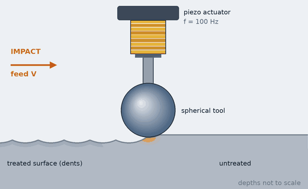

# Piezopeening Coverage Simulator

**Dr Régis Kubler**, Arts et Métiers Institute of Technology
*Developed with the assistance of Claude Opus 5.5 (Anthropic), October 2026*

Interactive educational tool showing how surface coverage builds up in
**piezopeening**: a spherical tool driven by a piezoelectric actuator hammers
the surface at frequency *f* while a CNC machine moves it along straight lines
at the feed velocity *V_feed*.

**▶ Live simulator:** https://YOUR-USERNAME.github.io/piezopeening-coverage/

## What the simulator shows
- Top view of the treated zone: tool path and every dent footprint
- Side view of the tool kinematics: penetration h(t) = U_off + a·sin(2πf·t) and contact phases
- Impact spacing, dent radius, dent length / width / aspect ratio, contact time
- Impact velocity (normal, tangential, resultant) and impact angle
- Map of how many times each point is hit, and its histogram
- Animated map of the final dent depth (deepest trace kept), with a rainbow depth scale and user-selected depth profiles across and along the feed and the theoretical ridge and scallop heights
- Share of the surface at 0 %, 100 %, 200 % and ≥ 300 % local coverage
- Comparison with a random process (shot peening) with the same mean number of hits
- One-pass coverage versus step-over, with the gap-free limit

All parameters can be set with sliders or typed values: tool diameter, frequency,
amplitude, offset, penetration efficiency, feed velocity, step-over, phase shift
between lines, tool path, number of passes and offset between passes.

## Model
- Tool tip penetration: h(t) = η·(U_off + a·sin(2πf·t)); contact when h > 0
  (h > 0 means the tip is below the initial surface)
- Impact spacing along a line: s = V_feed / f
- Dent radius at maximum penetration: r = √(2R·h_max − h_max²), R = tool radius
- Footprint: union of the contact circles while the tool moves during contact
- Mean hits per point per pass: λ = A / (s·p), p = step-over
- Normal impact velocity: v_n = 2πf·√(a² − U_off²); impact angle from the normal: atan(V_feed / v_n)

## Coverage above 100 % (NF L 06-832)

The base time t_b is the time needed to dent 98 % of the measured zone, counted in lines travelled. Full coverage (100 %) is 1.25 × t_b (an option sets it to t_b). The readout "Coverage (NF L 06-832)" combines both: it is the dented area up to the base time t_b (98 %), goes from 98 % to 100 % between t_b and 1.25·t_b, and is 100·t / (1.25·t_b) above (200 % = twice the time of full coverage).

Version 1.9 (18 November 2026): new readouts "Base time" and "Coverage (NF L 06-832)", which can exceed 100 %; option for the 1.25 factor.

Version 1.8 (18 November 2026): the equivalent coverage level and the 1.25 option are removed; coverage is the dented area divided by the total area.

## Use
Open the live link above, or download `index.html` and open it in any web
browser (works offline; no installation needed).

## Limitations
Educational kinematic model: rigid spherical tool with imposed sinusoidal
motion; the dent is the trace of the sphere. Elastic recovery, actuator
stiffness, material pile-up and friction are not modelled. Use the
penetration efficiency η to calibrate against measured dent diameters.

## Author and acknowledgement
Dr Régis Kubler, Arts et Métiers Institute of Technology.
The simulator was developed with the assistance of Claude Opus 5.5 (Anthropic),
October 2026. All content was reviewed by the author.

## Licence
Code: MIT, see [LICENSE](LICENSE). Documentation: CC BY 4.0.

## Cite as
Kubler, R. (2026). *Piezopeening Coverage Simulator*. Arts et Métiers Institute of Technology. Zenodo. DOI: [to add]
